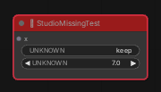

# Original दृश्य की जाँच

5 नवंबर 2026 को Chromium 153 में रिपॉज़िटरी के निर्धारित ComfyUI कमिट `56f179f` और frontend `1.58.5` पर जाँच की गई। दोनों सर्वर स्थानीय थे। ComfyUI CPU मोड में चला।

## पुराने Preview में क्या हुआ

`df8ed78` पर एक अलग, खाली वर्कफ़्लो खोलकर **Original** दबाया। iframe का पता `/?studio_canvas=1` सही था और `/_studio/ready` ने उपलब्ध बैकएंड बताया। iframe के load पर `/scripts/app.js` ने `window.comfyAPI.app` को उसके तैयार होने से पहले पढ़ा। ब्राउज़र ने `Cannot read properties of undefined (reading 'app')` दिखाया। उस कोशिश में वर्कफ़्लो लोड करने वाली पंक्ति तक कोड पहुँचा ही नहीं। कोड में उस पंक्ति पर स्थिर `/_studio/workflow` भी मिला। Editor बटन दबाने के बाद ब्राउज़र में Original iframe ही दिखाई देता रहा।

## सुधार के बाद जाँच

| जाँच | ब्राउज़र में परिणाम |
|---|---|
| ताज़े प्रोफ़ाइल में पहली बार खोलना | ComfyUI के तैयार होने और उसके टैब बहाल होने के बाद चुना हुआ ग्राफ़ खुला। पहली बार दिखने वाला Templates पैनल रास्ते से हट गया। |
| H3 JSON को खींचकर Studio में छोड़ना | आयातित टैब Original में 60% पर खुला। उसी JSON को सीधे ComfyUI में खोलकर सभी 22 नोड के ID, प्रकार, widget के नाम, इनपुट और आउटपुट के नाम तथा 29 लिंक की तुलना की। दोनों के परिणाम समान थे। |
| कस्टम controls | H3 Audio Controller में सचमुच का audio player और फ़ाइल चुनने का बटन बना। H3 Video Controller की width को 896 करने पर उसकी अपनी extension ने preset को Custom किया। |
| Missing नोड | परीक्षण में PixaromaLoadVideo और MiniMaxH3TextEncoderCache उपलब्ध नहीं थे। अलग परीक्षण नोड पर Classic Canvas में लाल header और चारों तरफ़ लाल outline देखी। Vue मोड में भी outline का रंग `#ef3349` और header का `#991b1b` मिला। |
| बदलाव वापस लेना | परीक्षण नोड को [60, 90] पर ले जाकर **Studio में कॉपी** दबाया। नया टैब खुला। उसमें स्थिति, [250, 90] आकार, इनपुट port, properties और दोनों saved widget values मिले। |
| मौजूदा editor | Dashboard और Editor में वापस गए। Node Manager ने बैकएंड के 1040 पंजीकृत प्रकार पढ़े। H3 का JSON Export और Save As दोनों किए। सेव की गई फ़ाइल फिर पढ़ने पर 29 लिंक मिले। |
| बैकएंड अनुपलब्ध | readiness में अनुपलब्ध स्थिति देकर Original खोला। संदेश दिखा और Editor में लौटने पर परीक्षण ग्राफ़ उपलब्ध था। |

Classic Canvas में परीक्षण नोड का वास्तविक ब्राउज़र चित्र:

दोनों catalog scripts और H3 की frontend extensions लोड हुईं। जाँच में कोई अनहैंडल्ड JavaScript exception नहीं मिला। ताज़े प्रोफ़ाइल की वैकल्पिक user CSS, खाली userdata और उदाहरण की अनुपस्थित मीडिया फ़ाइलों के लिए ComfyUI ने कुछ HTTP 404 लौटाए।

## अपने वर्कफ़्लो में इस्तेमाल

1. स्थानीय ComfyUI चलाएँ और फिर `START-DOLORAIN-LOCAL.bat` खोलें।
2. Studio में अपना वर्कफ़्लो चुनें और **Original** दबाएँ। उसी टैब की वर्तमान कॉपी असली ComfyUI में खुलती है।
3. Native बदलाव वापस Studio में लाने के लिए **Studio में कॉपी** दबाएँ। नए टैब को जाँचकर Save करें। सामान्य Editor बटन दबाने से पहले वाला Studio टैब फिर दिखता है।

अनुपलब्ध pack का ख़ास widget चलाने के लिए उसकी frontend extension चाहिए। उस स्थिति में ComfyUI अपने पास उपलब्ध संरचना और मान दिखाता है। इस जाँच में GPU generation, ऑडियो प्लेबैक, pack स्थापना और Windows Edge पर प्रत्यक्ष परीक्षण शामिल नहीं थे।
